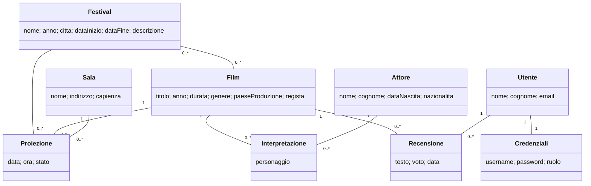

# Siw-festival

Applicazione web per la gestione di **festival cinematografici**: film, festival, sale, proiezioni, cast e recensioni.
Progetto per l'esame di Sistemi Informativi su Web (SIW).

## Tecnologie

Spring Boot, Spring MVC, Spring Data JPA / Hibernate, Spring Security (login con ruoli, password BCrypt),
Thymeleaf, PostgreSQL, Maven. In piu': API REST (JSON) e frontend React senza build (React e Babel da CDN).

## Come avviarlo

1. Creare in PostgreSQL (pgAdmin) un database vuoto chiamato `Siw-festival`.
2. Controllare username e password in `src/main/resources/application.properties`.
3. Avviare `SiwFestivalApplication` (Run As > Spring Boot App) e aprire `http://localhost:8080`.
4. La versione React si apre su `http://localhost:8080/app/`; le API REST sono sotto `http://localhost:8080/api/...`.

All'avvio Hibernate crea le tabelle (`ddl-auto=create`) e carica i dati di prova da `src/main/resources/import.sql`
(a ogni avvio il database viene ricreato da zero, quindi i dati inseriti dal sito spariscono al riavvio).

Utenti di prova:

| Username | Password | Ruolo |
|---|---|---|
| `admin` | `admin` | ADMIN |
| `utente1` | `utente1` | USER |

## Modello di dominio



Scelte principali:

- **Film-Festival** e' molti-a-molti (un film partecipa a piu' festival): `@ManyToMany` con `Film` come lato proprietario.
- **Interpretazione** e' una classe e non una semplice `@ManyToMany` Film-Attore, perche' la relazione ha un dato suo (il `personaggio`).
- **Proiezione** collega festival, film e sala ed ha uno **stato** (`SCHEDULED`, `COMPLETED`, `CANCELLED`).
- **Utente / Credenziali** sono separati: l'anagrafica non viaggia insieme alla password.
- Le liste `@OneToMany` sono `LAZY`; le pagine che le mostrano usano `@EntityGraph` / `JOIN FETCH` per evitare il problema N+1.
  I `@ManyToOne` restano `EAGER` (scelta spiegata e misurata in `src/test/.../AnalisiFetchTest`).

## Funzionalita'

Attori: **visitatore** (non loggato), **utente** (ruolo USER), **amministratore** (ruolo ADMIN). Registrazione e login non sono contati.

| Caso d'uso | Attore | Tipo |
|---|---|---|
| Inserire un film, un festival, una sala | admin | inserimento |
| Modificare un film, una sala | admin | aggiornamento |
| Associare e rimuovere film di un festival | admin | inserimento / cancellazione |
| Programmare una proiezione (film, festival, sala, data e ora) | admin | inserimento |
| Modificare o annullare una proiezione (stato `CANCELLED`) | admin | aggiornamento / cancellazione logica |
| Scrivere, modificare ed eliminare la propria recensione di un film (una per utente e film) | utente | inserimento / aggiornamento / cancellazione |
| Consultare film (con regista, cast, festival, proiezioni, recensioni e voto medio), festival, sale, attori e proiezioni | tutti | lettura |

### Regole di programmazione di una proiezione

Una proiezione e' accettata solo se: il film fa parte del festival; la data cade nel periodo del festival;
la sala e' libera (nessun'altra proiezione non annullata si sovrappone, intervalli `[inizio, inizio + durata del film)`, anche a cavallo della mezzanotte).
L'operazione e' atomica (`@Transactional`) con isolamento `SERIALIZABLE`, per evitare che due amministratori programmino la stessa sala nello stesso momento.

## API REST e frontend React

Le API restituiscono JSON e usano i codici HTTP: `200` ok, `201` creato (con `Location`), `204` nessun contenuto, `400` dati non validi
(con l'elenco dei campi), `401` non autenticato, `403` non consentito, `404` non trovato, `409` conflitto (duplicato, sala occupata, risorsa in uso).

| Risorsa | Endpoint principali |
|---|---|
| Film | `GET /api/films?titolo=&genere=&regista=&page=&size=`, `GET /api/films/{id}`, `GET /api/films/generi`; `POST` / `PUT` / `DELETE` solo ADMIN |
| Recensioni | `GET /api/films/{id}/reviews`, `POST /api/films/{id}/reviews`, `PUT` / `DELETE /api/reviews/{id}` (solo l'autore) |
| Festival | `GET /api/festivals`, `/{id}`, `/{id}/movies`, `/{id}/screenings`; scrittura solo ADMIN |
| Proiezioni | `GET /api/screenings?data=AAAA-MM-GG`, `/{id}`; `POST` / `PUT` / `DELETE` (annulla) solo ADMIN |
| Sale | `GET /api/sale`, `/{id}`; scrittura solo ADMIN |
| Accesso | `POST /api/auth/login`, `GET /api/auth/me`, `POST /api/auth/logout` |

Sicurezza: due `SecurityFilterChain`, una per `/api/**` (risponde in JSON con 401/403) e una per il sito. La sessione e' la stessa del sito;
le richieste che modificano dati richiedono il token CSRF (cookie `XSRF-TOKEN`, header `X-XSRF-TOKEN`).
Il frontend React (`/app/`) usa solo le API: ricerca e dettaglio dei film con recensioni, festival, programma delle proiezioni e accesso dal modulo in alto.

## Struttura del codice

```
controller/    pagine pubbliche, area admin (/admin/**), gestione errori
service/       logica di business e transazioni
repository/    interfacce Spring Data (query derivate, @Query, @EntityGraph)
model/         entita' JPA
dto/           ProiezioneForm (modulo) e record JSON dell'API (ApiDto)
rest/          controller REST (@RestController), mapper e gestione errori JSON
validation/    validatore personalizzato (anno non nel futuro)
exception/     eccezioni di dominio (NotFound, ProgrammazioneNonValida, OperazioneNonConsentita)
configuration/ Spring Security
static/app/    frontend React (index.html, api.js, main.jsx, components.jsx, app.css)
```
